<!-- Profile README for github.com/thiyagu-sz. The SVG cards are regenerated daily by .github/workflows/readme-cards.yml -->

  

  
  
  

  

  

  <a href="https://www.thiyagudev.online/">Portfolio</a> ·
  <a href="https://linkedin.com/in/thiyaguai">LinkedIn</a> ·
  <a href="mailto:thiyaguai2004@gmail.com">Email</a>

